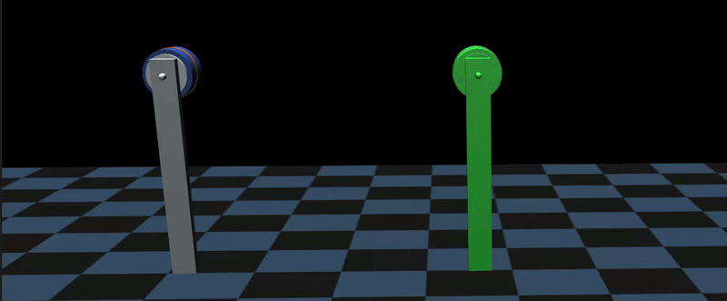
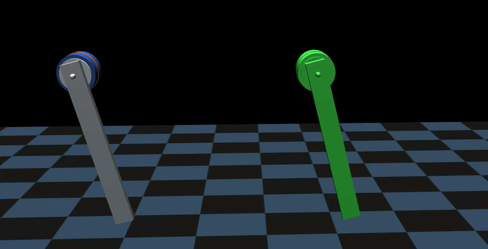

# Mujoco System Identification

System identification framework built on MJX + MuJoCo.

[Open demo video](https://wavegit.mipt.ru/Slavoch/mjx_sysid/-/raw/main/docs/IROS25_1428_VI_fi.mp4)

## Qualitative Comparison

The animations below compare behavior before and after system identification. The green motor follows the replayed real trajectory, while the other motor is the simulated one. Closer alignment between them means the simulation matches the real system more accurately.

### Before System Identification



### After System Identification




## Installation

### 1) Create virtual environment
```bash
python3.11 -m venv venv
source venv/bin/activate
```

### 2) Install dependencies
```bash
pip install mujoco mujoco_mjx brax pandas tensorboardX
pip install -U "jax[cuda12]"
```

### 3) Install this project
```bash
pip install -e .
```

---

## Usage

### List available tasks
```bash
python scripts/optimize.py --list-tasks
```

### Train/optimize a task
```bash
python scripts/optimize.py --task=roki2.torque
```

Outputs are saved to:
- `runs/<task>/<timestamp>/config.json`
- `runs/<task>/<timestamp>/result.json`
- `runs/<task>/<timestamp>/best_params.pkl`
- `runs/<task>/<timestamp>/checkpoints/*.pkl`

### Replay raw dataset (no simulation)
```bash
python scripts/dataset_play.py --task=roki2.torque
```

### Replay learned model vs reference (simulation)
`experiment_play.py` always opens the MuJoCo viewer.

```bash
python scripts/experiment_play.py \
  --task=roki2.torque \
  --checkpoint=/absolute/path/to/checkpoint.pkl
```

After one playback completes, press Enter to replay.

---

## How To Train The Model You Need

### 1) Pick a base task
Start from an existing task in `config/tasks/`, for example `config/tasks/roki2.py`.

### 2) Adjust task config
In task config, update:
- `data.dataset_path`, `data.dt`, `data.motor_id`, `data.num_lags`
- `sim.model_xml`, solver/integrator settings
- `train.max_iter`, `train.batch_size`, `train.learning_rate`
- `experiment.controllers`, `experiment.frictions`, `experiment.changers`

### 3) Register task key
Add your task into `config/registry.py` (`TASK_REGISTRY`) so it becomes runnable from CLI.

### 4) Run training
```bash
python scripts/optimize.py --task=<your.task.key>
```

---

## How To Add Models

Core model factories live in `sysidmjx/models.py`.

You can add:
- controller factories (`get_controller_*`)
- friction factories (`make_friction_*`)
- parameter changers (`make_changer_*`)

Expected pattern:
- a factory receives init specs/hyperparameters
- returns `(callable_fn, init_params_dict)`
- callable is JAX-friendly and typically `@jax.jit`

Then reference your new function in task config using `ComponentConfig(func=..., params=...)`.

---

## TensorBoard: How To Monitor Learning

Runs are logged with `tensorboardX` under `runs/<task>/<timestamp>/`.

Start TensorBoard from repo root:
```bash
tensorboard --logdir runs
```

Useful curves:
- `train/loss`
- `train/grad_norm`
- `train/loss_qpos`
- `train/loss_qvel`
- scalar params under `params/...` (when parameter set is small)

---

## Dataset Structure

Loader: `sysidmjx/assets/single_motor/dataloader/single_joint.py`

Dataset is a CSV with lagged columns. For each feature in `{qpos, qvel, qact}` and each lag `k` in `[0..num_lags]`, required column name is:

`<feature>_motor<motor_id>_lag<k>`

Example for `motor_id=0`, `num_lags=3`:
- `qpos_motor0_lag0`, `qpos_motor0_lag1`, `qpos_motor0_lag2`, `qpos_motor0_lag3`
- `qvel_motor0_lag0`, ... `qvel_motor0_lag3`
- `qact_motor0_lag0`, ... `qact_motor0_lag3`

Notes:
- CSV rows with NaN are dropped.
- `lag0` is current state/action.
- `lag1..lagN` are used as future targets for training.

---

## Cite us

If you use this project in your research, please cite:

```bibtex
@inproceedings{kovalev2025achieving,
  title={Achieving Precise and Reliable Locomotion with Differentiable Simulation-Based System Identification},
  author={Kovalev, Vyacheslav and Chaikovskaia, Ekaterina and Davydenko, Egor and Gorbachev, Roman},
  booktitle={2025 IEEE/RSJ International Conference on Intelligent Robots and Systems (IROS)},
  pages={4767--4772},
  year={2025},
  organization={IEEE}
}
```