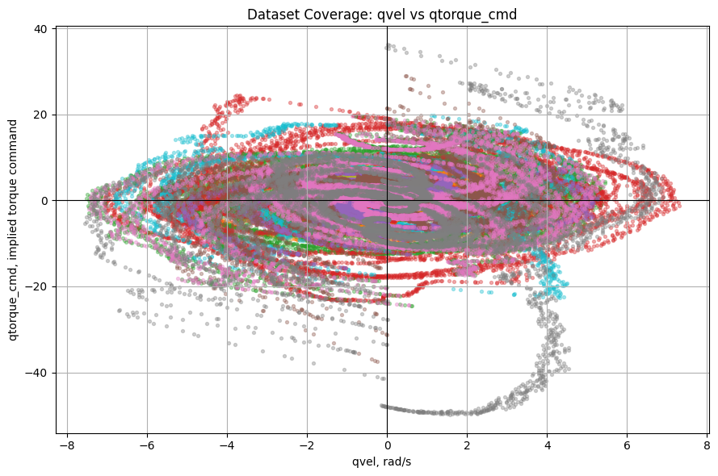
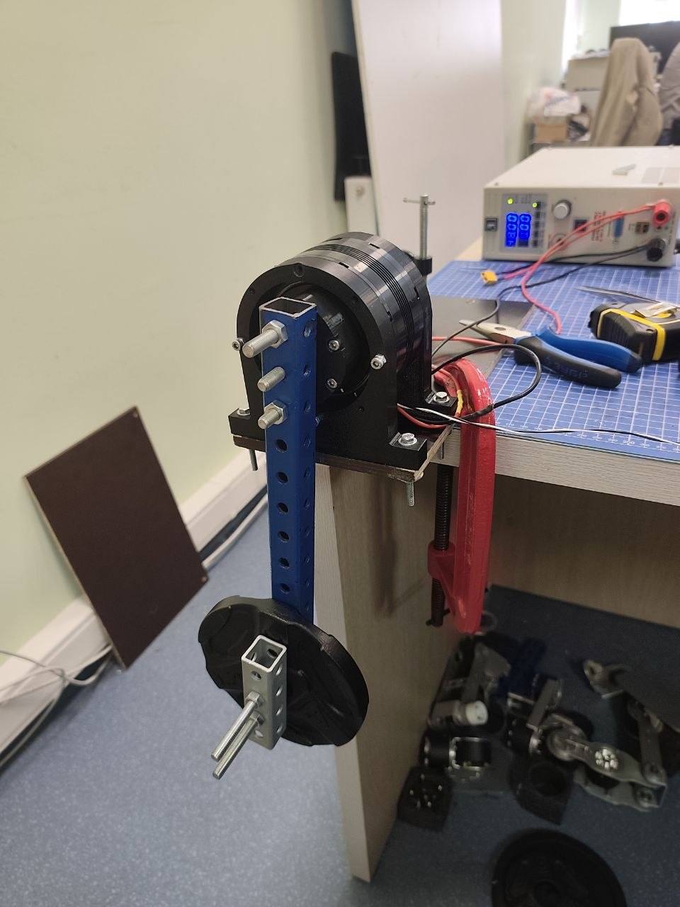
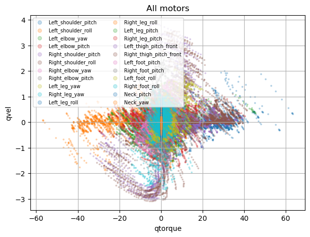

# Datasets

[← Documentation overview](../README.md#documentation)

A dataset is a collection of motor trajectories recorded with the same physical setup represented by the [MuJoCo plant model](xml.md). Good identification depends on both measurement quality and coverage of the motor's operating range.

## CSV format

Store each trajectory in a separate CSV file. Four columns are required:

| Column | Meaning | Unit |
| --- | --- | --- |
| `time_s` | Sample timestamp | s |
| `qpos` | Motor position | rad |
| `qvel` | Motor velocity | rad/s |
| `qact` | Command sent to the actuator | controller-dependent |

Rows containing missing values are dropped when the dataset is loaded. Every remaining trajectory must be longer than `history_len + prediction_horizon`.

Add any signals needed to reconstruct your control law as extra columns. For example, the bundled PD datasets include `kp`, `kd`, and `target_qvel`; their `qact` column contains the target position. `DatasetSpec.rollout_fields` maps the names expected by a motor model to the corresponding CSV columns:

```python
DatasetSpec(
    model_xml="assets/robots/encos80/encos8112_test.xml",
    runs=("path/to/train_trajectory.csv",),
    val_runs=("path/to/validation_trajectory.csv",),
    rollout_fields={
        "target_qpos": "qact",
        "target_qvel": "target_qvel",
        "kp": "kp",
        "kd": "kd",
    },
)
```

Paths may be absolute or relative to the repository root.

## Collect useful trajectories

Use signals that collectively cover the positions, velocities, accelerations, and commands expected in operation. A practical set usually combines:

- chirps for broad frequency coverage;
- sine waves at several amplitudes and frequencies;
- steps for transient response;
- slow ramps for low-speed friction;
- holds near zero velocity for static behavior.

Avoid relying on one long repetitive trajectory. Several distinct runs make it easier to detect gaps in coverage and reserve complete trajectories for validation.

The bundled Encos8112 data illustrates the desired state-space coverage:



## Match the physical setup

Record data with the same motor, load, mounting, and controller assumptions used by the XML model. For the included experiment, one motor was disconnected from the robot and mounted on a bench with a measured load:



The source robot data was used to estimate the operating envelope before designing bench trajectories:



## Filter noisy measurements

The included Savitzky–Golay utility smooths position and derives velocity from the smoothed position:

```bash
python scripts/filter_motion_sg.py path/to/dataset
```

For an input directory named `dataset`, it creates:

```text
dataset_sg/
├── <trajectory>.csv
└── figures/
    └── <trajectory>.png
```

The defaults are a window length of `111` and polynomial order `3`. Override them when the sample rate or motion bandwidth requires it:

```bash
python scripts/filter_motion_sg.py path/to/dataset --window 51 --polyorder 3
```

The window must be odd, larger than the polynomial order, and no longer than the trajectory.

The registered Encos8112 tasks reference `assets/datasets/encos8112_4p25kg_servant_sg`. If that generated directory is absent, create it before optimization:

```bash
python scripts/filter_motion_sg.py assets/datasets/encos8112_4p25kg_servant
```

## Quality checks

Before training:

1. Confirm timestamps are monotonic and approximately uniform.
2. Check that position and velocity use the same sign convention as the XML joint.
3. Compare measured velocity with the derivative of position.
4. Plot command coverage and remove long saturated or inactive segments.
5. Look for protection modes, dropped commands, discontinuities, and encoder resets.
6. Keep validation trajectories representative but independent from training when possible.

For the bundled data, `mark_required_torque.py` helps expose periods where the mechanism requires torque but the logged command is nearly zero:

```bash
python scripts/mark_required_torque.py assets/datasets/encos8112_4p25kg_servant
```

By default this creates `assets/datasets/encos8112_4p25kg_servant_gt/`, adds inverse-dynamics `torque`, adds `sent_torque` when the required PD fields are present, and writes diagnostic figures under `figures/`. Use `--output` to choose another destination or `--model-xml` to select another plant model.

Use checks like this to understand anomalies before deciding whether to clean or remove affected segments.
