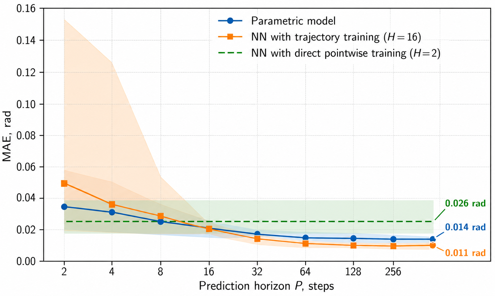

# Training and optimization

[← Documentation overview](../README.md#documentation)

Each task defines data windows in `DataConfig`, optimizer settings in `TrainConfig`, and output behavior in `LoggingConfig`. Start from a bundled task and change one group of settings at a time.

## Trajectory windows

Three `DataConfig` fields determine what each optimization sample contains:

| Field | Purpose |
| --- | --- |
| `history_len` | Past samples of position, velocity, action, and control fields available to the motor model |
| `prediction_horizon` | Number of future simulation steps included in the training loss |
| `val_prediction_horizon` | Future steps used by the windowed validation loss; `None` uses the training horizon |

For a trajectory with `N` rows, the loader creates:

```text
N - history_len - prediction_horizon + 1
```

training windows. A trajectory must therefore contain at least `history_len + prediction_horizon` rows.

Longer prediction horizons penalize accumulated drift and usually produce models that roll out more reliably, but they increase compilation time, memory use, and optimization difficulty. Values around `30–100` worked well for the bundled data.

Increase `history_len` only for models that use signal history. Keep it equal to any `history_len` passed in a component's parameters.

## Optimizer settings

| `TrainConfig` field | Effect | Practical guidance |
| --- | --- | --- |
| `seed` | Parameter initialization and batch sampling | Repeat promising runs with several seeds |
| `max_iter` | Maximum Adam updates | Raise after confirming the setup learns |
| `batch_size` | Random windows per update | Increase until memory becomes limiting |
| `learning_rate` | Initial Adam learning rate | Lower it if loss or parameters oscillate |
| `learning_rate_final` | Final exponential-decay rate; `None` keeps a constant rate | Use for longer runs that need fine convergence |
| `early_stop_patience` | Updates without sufficient validation improvement before stopping | Keep below `max_iter` when early stopping is desired |
| `early_stop_min_delta` | Minimum validation-loss decrease counted as improvement | Raise to ignore insignificant noise |
| `loss_w_qpos` | Position-loss weight | Keep positive when trajectory tracking is the main goal |
| `loss_w_qvel` | Velocity-loss weight | Increase only when velocity measurements are trustworthy |
| `loss_qpos_scale` | Position residual scale | Set near a meaningful position-error magnitude |
| `loss_qvel_scale` | Velocity residual scale | Set near a meaningful velocity-error magnitude |
| `loss_huber_delta` | Pseudo-Huber scale; `None` uses squared residuals | Use the robust penalty when occasional outliers dominate |

Residual scales make position and velocity errors dimensionless before weighting. They are configuration values, not statistics estimated from the dataset.

## Training and validation behavior

At every update, training samples a random batch of trajectory windows. At each `logging.log_every` interval, the runner evaluates:

- the full set of training windows;
- the full set of validation windows from `DatasetSpec.val_runs`;
- the current gradient norm, learning rate, and learned scalar parameters.

`best_params.pkl` is selected by the windowed validation loss. Periodic snapshots are also saved under `checkpoints/`.

Windowed validation is useful during optimization, but it is not the final test. After training, replay complete trajectories with the same command sequence to reveal long-term drift; see [Validation](validation.md).

The optimizer enables JAX 64-bit mode. In the bundled Encos8112 tasks, training uses a horizon of `64`, validation uses `100`, and validation is evaluated every `50` updates. Their `runs` and `val_runs` currently contain the same trajectories, so the validation score selects checkpoints at a longer horizon but is not held-out performance.

## Logging settings

| `LoggingConfig` field | Purpose |
| --- | --- |
| `runs_root` | Root output directory, default `runs` |
| `log_every` | Interval for full train/validation evaluation and TensorBoard logging |
| `checkpoint_every` | Interval for periodic parameter snapshots |

Frequent logging can be expensive because it evaluates all configured windows.

Early-stopping progress is checked only at logging intervals. The no-improvement counter advances by `log_every`, so `early_stop_patience` is expressed in optimization-update units rather than a number of validation checks.

## Tuning strategy

1. Begin with `frictionloss`, `damping`, and `armature`.
2. Use a short run to verify that loss decreases and parameters remain plausible.
3. Inspect full-trajectory playback before increasing model complexity.
4. Increase the prediction horizon when short-window loss is good but long rollouts drift.
5. Add velocity loss only after checking velocity quality.
6. Add richer friction or neural residuals only for repeatable structure left in the error.
7. Compare several random seeds and validation trajectories.

## Prediction-horizon example

The plot below compares validation error across prediction horizons for parametric and history-based models:



On this dataset, larger horizons reduced both error and run-to-run spread. Treat that as a starting observation rather than a universal optimum: the best horizon depends on timestep, trajectory length, model complexity, and available memory.
