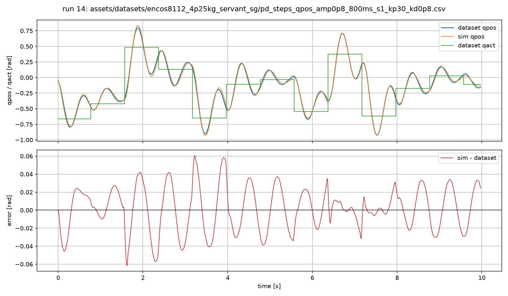
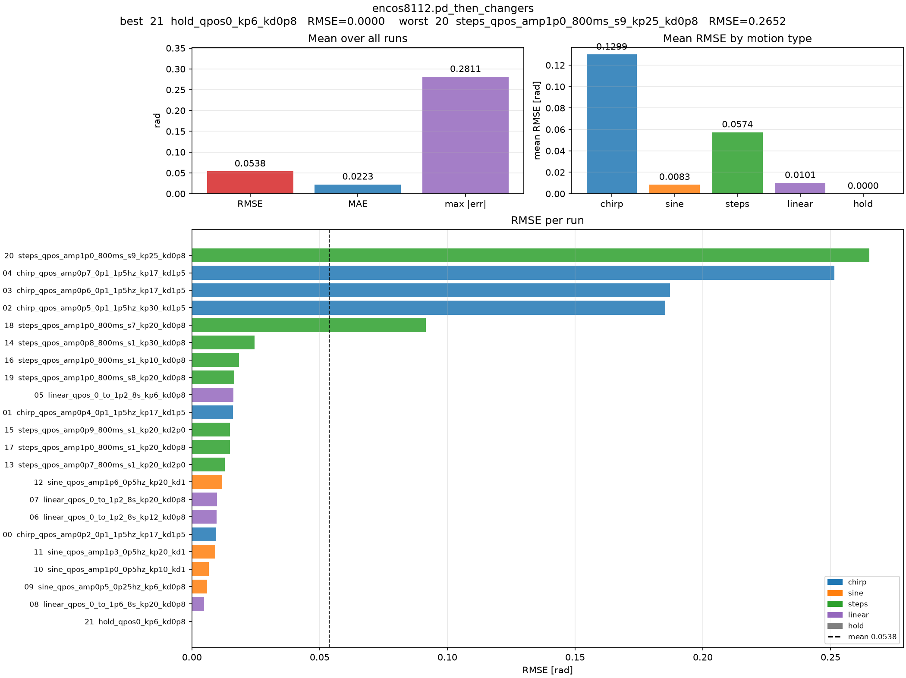

# Validation

[← Documentation overview](../README.md#documentation)

A low training loss does not guarantee a useful actuator model. Validate by rolling the simulator through complete recorded command sequences and checking both aggregate errors and trajectory shape.

## Monitor optimization

Start TensorBoard from the repository root:

```bash
tensorboard --logdir runs
```

Useful series include training and validation loss, position and velocity components, gradient norm, learning rate, and individual learned parameters. The optimizer saves the parameter set with the lowest windowed validation loss as `best_params.pkl`.

## Inspect the recorded motion

Replay the first trajectory from a task without running physics:

```bash
python scripts/dataset_play.py --task=encos8112.pd_then_changers
```

This writes measured `qpos` and `qvel` directly into the MuJoCo viewer at the configured timestep. Use it to check joint direction, scale, timing, and the physical interpretation of the XML.

## Compare simulation with one trajectory

Replay a checkpoint beside the recorded motion:

```bash
python scripts/experiment_play.py \
  --task=encos8112.pd_then_changers \
  --checkpoint=runs/encos8112.pd_then_changers/<timestamp>/best_params.pkl \
  --run-index=0
```

The viewer uses a generated twin model: the green copy follows the dataset while the other runs the learned simulation. Rollout begins at sample `history_len - 1`, using the preceding samples as model history. Change `--run-index` to inspect another configured trajectory.

The playback script regenerates a sibling `<model>_twin.xml` next to the task's source XML.

## Evaluate every configured trajectory

Generate per-run plots and summary metrics:

```bash
python scripts/plot_task_runs.py \
  --task=encos8112.pd_then_changers \
  --checkpoint=runs/encos8112.pd_then_changers/<timestamp>/best_params.pkl
```

Results are written under the checkpoint's run directory:

```text
playback_figures/
├── 00_<trajectory>.png
├── 01_<trajectory>.png
├── ...
├── metrics.csv
└── summary.png
```

`metrics.csv` reports position RMSE, MAE, maximum absolute error, its sample index, and trajectory length. `summary.png` compares errors across individual runs and motion types.

### One-trajectory rollout

Each trajectory figure overlays the recorded position, simulated position, and actuator command. The lower panel shows the position error over time:



This example shows close tracking over a ten-second step trajectory while still exposing the small phase and amplitude errors that aggregate metrics alone would hide.

### Summary across trajectories

The summary groups RMSE by motion type and ranks every trajectory:



In this dataset, the mean RMSE is dominated by a few high-error chirp and step trajectories. These recordings contain intervals where the physical motor enters protection mode and no longer follows the nominal command law. Because the protection state is not present in the logged inputs, the simulator cannot reproduce those intervals from the command alone. A high RMSE on these runs therefore indicates a dataset/model-input limitation, not necessarily poor identified dynamics across the normal operating region.

Keep such runs visible in the report, but inspect them separately and document whether they should be excluded, segmented, or modeled with an additional protection-state signal.

## What to look for

- **Growing phase error:** timestep, damping, armature, or command timing may be wrong.
- **Bias near zero velocity:** static or Coulomb friction is probably under-modeled.
- **Good short windows but drifting full rollouts:** increase the prediction horizon.
- **Failure only at high speed or command:** collect more coverage and consider velocity-dependent effects.
- **Large improvement on training trajectories only:** simplify the model or add independent validation runs.
- **Unstable or implausible parameters:** narrow initialization ranges and verify units and signs.

Use complete trajectories not seen during fitting whenever possible. The bundled tasks currently configure their validation runs explicitly in `DatasetSpec.val_runs`; inspect or change those paths before treating the reported validation loss as held-out performance.
